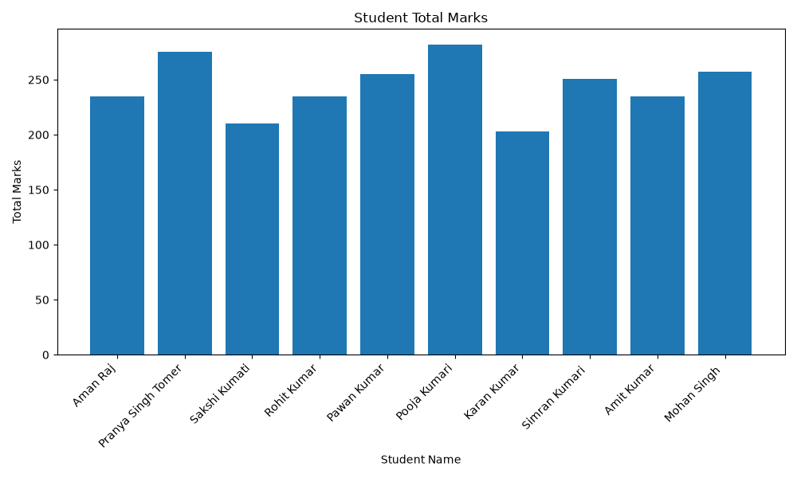
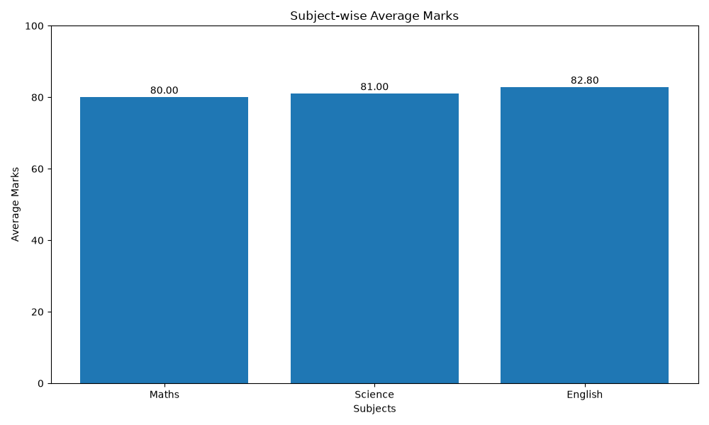
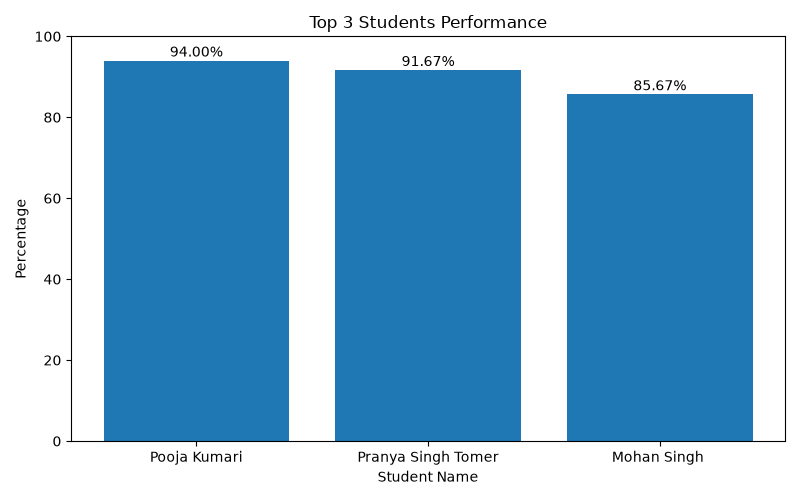

Student Performance Analytics System

Project Overview

The Student Performance Analytics System is a Python-based data analysis project developed as part of the EWB Courses Python with AI internship assignment.

Technologies Used

- Python
- NumPy
- Pandas
- Matplotlib

Features

- Reads student records from a CSV file.
- Calculates total marks and average percentage.
- Assigns grades based on performance.
- Identifies pass and fail students.
- Displays highest and lowest marks.
- Performs subject-wise performance analysis.
- Identifies the top 3 performing students.
- Generates charts for student performance.
- Exports the top 3 students report to a CSV file.

Project Files

- "main.py" — Main Python program.
- "students.csv" — Student dataset.
- "top_3_students_report.csv" — Generated top 3 students report.

How to Run

1. Install Python.
2. Install required libraries using "pip install pandas numpy matplotlib".
3. Open the project folder in VS Code.
4. Run "python main.py" in the terminal.

Author

Aman Raj

Internship

EWB Courses — Python with AI
## Project Charts

### 1. Student Total Marks

### 2. Subject-wise Performance

### 3. Top 3 Students

